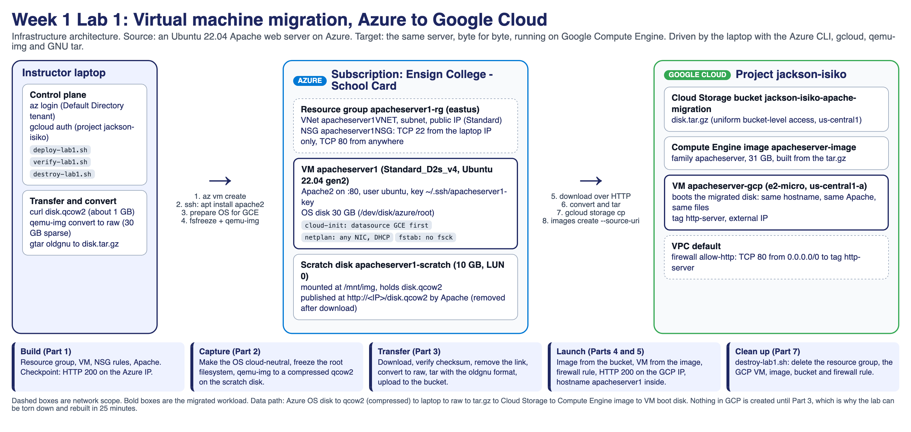
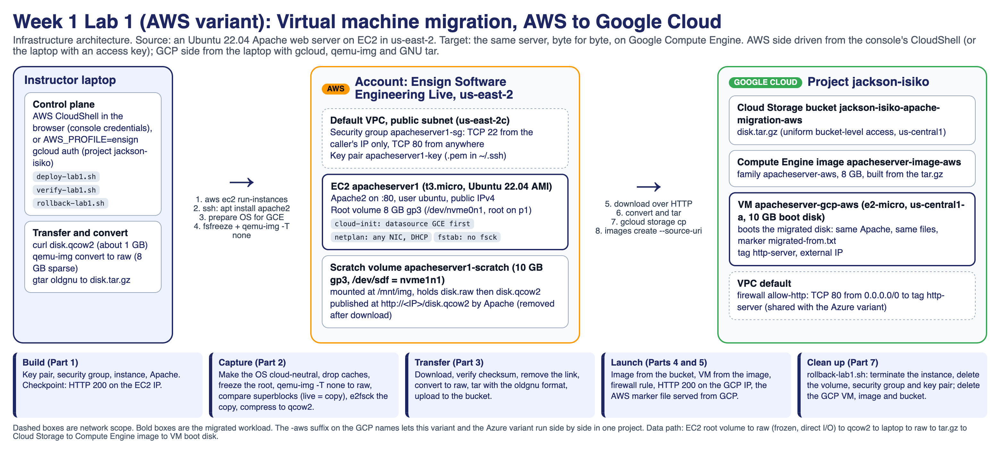
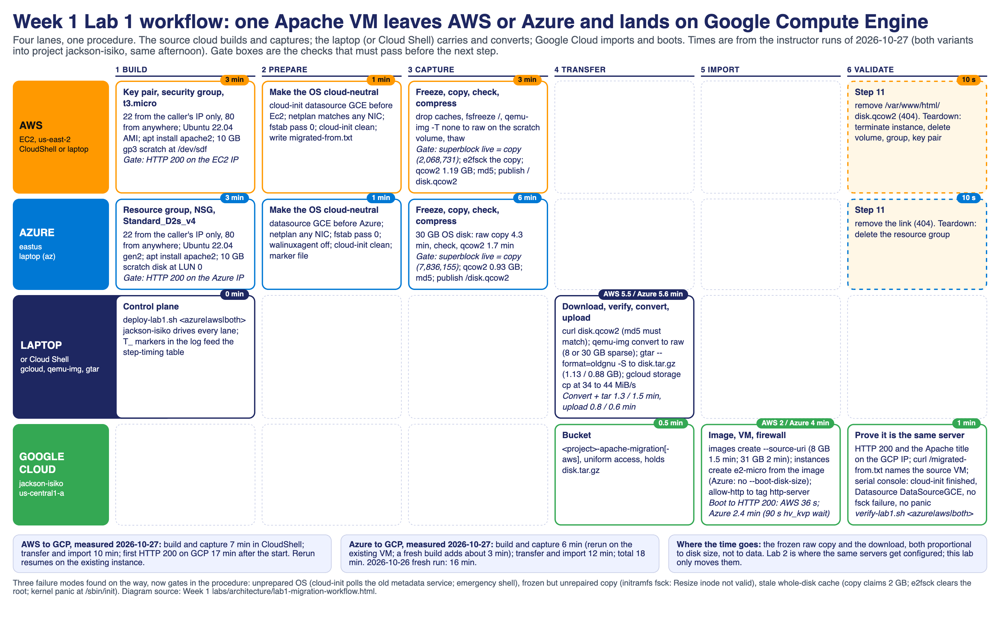
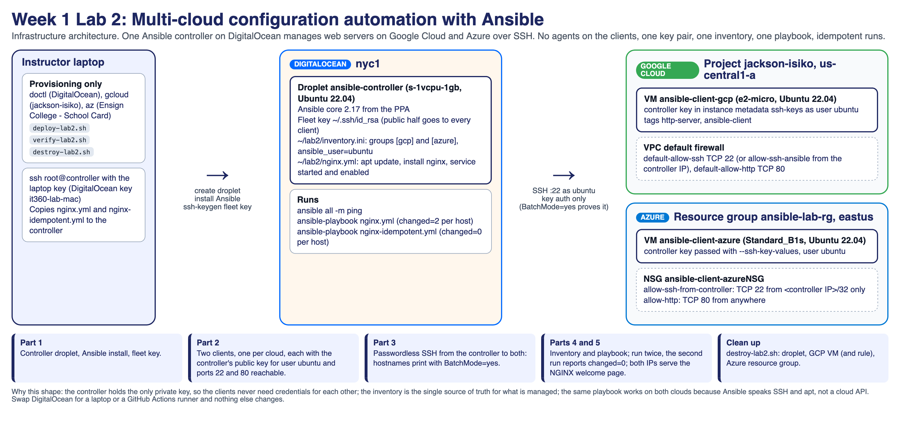

# Week 1 architecture

Three infrastructure architectures (Lab 1 from Azure, Lab 1 from AWS, Lab 2) and one workflow view of Lab 1 with the time each step takes. Use them on the slide before each lab, in
the Team Project Report (Week 1 kickoff asks for a proposed cloud solution: these are worked
examples of how to draw one), and as the map students annotate with their own IPs.

## Lab 1: virtual machine migration, Azure to Google Cloud

**What the diagram says.** The workload is one Ubuntu 22.04 VM running Apache. Azure holds the
source (resource group, VNet, NSG, VM, a 10 GB scratch disk that receives the captured image).
Google Cloud holds the target (bucket, custom image, VM, firewall rule). The laptop is the
control plane and the data path: it drives both CLIs and carries the compressed disk image from
one cloud to the other. Nothing on the GCP side exists until the image is uploaded, which is why
the lab tears down and rebuilds in about 25 minutes.

**Design decisions worth saying out loud.**

- Why capture to a scratch disk and serve it over HTTP instead of using a cloud-specific export?
  Because every cloud can serve a file, so the same procedure works from AWS (the original
  variant), Azure, or any hypervisor. The trade-off is that HTTP is unauthenticated, which is why
  the link is removed right after the download (Step 11).
- Why does the Azure disk need preparation before capture (Step 6)? An Azure Ubuntu image boots
  fine on Compute Engine, but cloud-init polls the Azure metadata service forever, netplan pins
  `eth0` to the Azure MAC address, and fstab runs fsck on a crash-consistent root and drops to the
  emergency shell. Four one-line edits make the disk cloud-neutral. This is the real lesson of the
  lab: a VM image carries assumptions about the cloud it was born on.
- Why freeze, read direct, compare, then check? `fsfreeze -f /` flushes and blocks writes while
  `qemu-img` reads the device, so the copy is consistent. `-T none` (O_DIRECT) after a cache drop
  bypasses the whole-disk page cache, which can still hold the superblock from before the
  first-boot resize; a copy made through that stale cache claims 2 GB on a 30 GB root, and
  `e2fsck -fy` then clears every inode above 2 GB, so the migrated VM panics at `/sbin/init`.
  The two `Block count` lines (live and copy) must match before `e2fsck` runs on the copy. The
  instructor runs hit all three failure modes in turn: no preparation (emergency shell), frozen
  but unrepaired (initramfs fsck), and the stale superblock (kernel panic after a clean fsck).
- SSH is open only to the machine running the build (the NSG rule uses the caller's public IP).
  HTTP is open to everyone because the web page is the lab's proof of success.

## Lab 1, AWS variant: virtual machine migration, AWS to Google Cloud

**What changes from the Azure picture.** The source is an EC2 `t3.micro` in the default VPC of
us-east-2 (school account *Ensign Software Engineering Live*), with a security group instead of
an NSG and an 8 GB gp3 root volume instead of a 30 GB OS disk. The AWS side can run entirely in
the console's CloudShell, which carries the console's credentials, so no access key has to exist
on the laptop; the GCP side is the same laptop procedure. The GCP names carry an `-aws` suffix
(`apacheserver-image-aws`, `apacheserver-gcp-aws`, bucket `...-apache-migration-aws`) so both
variants can live in project `jackson-isiko` at once and the class can see the same web server
arrive from two clouds. Every design decision above holds: the preparation step (datasource
`GCE` before `Ec2`, netplan for any NIC, fstab pass 0), the frozen direct-I/O capture with the
superblock comparison, SSH from the caller's IP only, HTTP to everyone.

## Lab 1 workflow: both clouds to Compute Engine, with times

**What the diagram says.** Six phases (build, prepare, capture, transfer, import, validate) across
four lanes (AWS, Azure, laptop, Google Cloud). The source lane is the only thing that changes
between the two variants; the laptop and Google Cloud lanes are identical. Time badges are the
2026-10-27 instructor measurements (AWS to GCP 17 min, Azure to GCP 18 min). The gates (HTTP 200 on
the source, superblock live = copy, the marker file served from GCP) are what students must show.
The process document with the console (UI) paths and the per-step tables is
[`../lab1-migration-workflow/README.md`](../lab1-migration-workflow/README.md); the scripts
there (`deploy-lab1.sh`, `verify-lab1.sh`, `destroy-lab1.sh`, each taking `azure`, `aws` or
`both`) print the same timing table at the end of every run.

## Lab 2: multi-cloud configuration automation with Ansible

**What the diagram says.** One controller (DigitalOcean) holds the only private key and the
inventory. Two clients, one on Google Cloud and one on Azure, accept that key for user `ubuntu`.
The controller speaks SSH and `apt` to both, so one playbook configures both clouds and a second
run changes nothing (`changed=0`). The laptop only provisions; once the three VMs exist it is not
on the data path.

**Design decisions worth saying out loud.**

- Agentless: the clients run nothing but sshd. The controller is the only thing that needs
  Ansible installed.
- Least privilege on the network: the Azure NSG allows port 22 only from the controller's IP.
  On GCP the project's `default-allow-ssh` rule is used if present; otherwise the lab creates
  `allow-ssh-ansible` scoped the same way.
- The inventory is the system of record. Adding a third cloud is one more group and one more
  host line; the playbook does not change.
- Idempotence is the test. Run 1 shows `changed=2` per host (install, service); run 2 must show
  `changed=0`. If it does not, the playbook is describing actions, not state.

## Rebuilding the pictures

The diagrams are HTML files rendered with headless Firefox (`render.js`, Playwright). Edit the
HTML, then `node render.js lab1-azure-to-gcp-migration.html lab1-aws-to-gcp-migration.html
lab1-migration-workflow.html lab2-multicloud-ansible.html` (with `NODE_PATH` pointing at a folder that has Playwright installed).
They are deliberately plain HTML and CSS so students can copy the pattern for their own Team
Project Report architecture.
