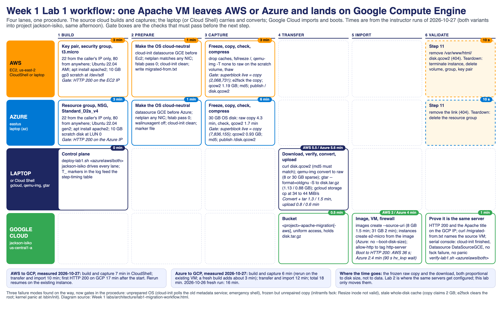

# Week 1 Lab 1 workflow: migrating a VM from AWS and from Azure to Google Compute Engine

This document is the process view of Lab 1. The two lab guides
([AWS variant](../aws-to-gcp-vm-migration/README.md), [Azure variant](../azure-to-gcp-vm-migration/README.md))
give every command; this one shows the workflow, how long each step takes, the console (UI)
path for people who prefer clicking to typing, and the three scripts that run the whole thing.



Times below were measured on 2026-10-27 with both variants running into GCP project
`jackson-isiko` the same afternoon (the two downloads shared one home connection, so transfer
times are a little pessimistic). The scripts now print this table themselves at the end of
every run (`Step timing (min:sec)`), so bring your own numbers to the debrief.

## 1. The workflow in one page

| Phase | What happens | Where | Gate before the next phase |
|---|---|---|---|
| 1 Build | Create the source VM with Apache; open 22 to the caller only, 80 to everyone; attach a 10 GB scratch disk | Source cloud | HTTP 200 on the source IP |
| 2 Prepare | Make the OS cloud-neutral: cloud-init datasource order (GCE first), netplan for any NIC, fstab pass 0, agent off, `cloud-init clean`, write `migrated-from.txt` | On the VM | `PREP_DONE` |
| 3 Capture | Drop caches, freeze `/`, raw copy of the whole root device with `qemu-img -T none`, thaw; compare the copy's superblock with the live root; `e2fsck` the copy; compress to qcow2; publish at `/disk.qcow2` | On the VM | `superblock block count: live=N copy=N`, md5 recorded |
| 4 Transfer | Download, verify md5, convert to raw, GNU tar `oldgnu` sparse to `disk.tar.gz`, upload to a bucket | Laptop or Cloud Shell | md5 matches |
| 5 Import | `images create --source-uri`, `instances create` from the image, firewall rule for tag `http-server` | Google Cloud | image `READY` |
| 6 Validate | HTTP 200 and the Apache title on the GCP IP; `migrated-from.txt` names the source; serial console shows `Datasource DataSourceGCE`, no fsck failure, no panic; remove the public link on the source (Step 11) | Laptop | both pages open side by side |

The procedure is identical for both clouds. Only the build phase and the device names differ:
Azure exposes `/dev/disk/azure/root` and `scsi1/lun0`; an EC2 `t3.micro` exposes `/dev/nvme0n1`
(root) and `/dev/nvme1n1` (scratch); a `t2.micro` shows `xvda` and `xvdf`.

## 2. Time per step

### AWS to GCP (account Ensign Software Engineering Live, us-east-2, CloudShell build)

| Step | Measured | Notes |
|---|---|---|
| Key pair, security group, instance running | 1 min | `t3.micro`, Ubuntu 22.04 AMI, default VPC |
| SSH ready, `apt install apache2`, HTTP 200 | 2 min | Apache page `Last-Modified 20:39:23Z` on a 20:36 start |
| Attach 10 GB gp3 scratch, Step 6 prep | 1 min | marker written 20:50Z |
| Freeze, raw copy of 8 GB, superblock check, e2fsck, qcow2 | 3 min | qcow2 1,186,012,160 bytes at 20:53Z; `live=2068731 copy=2068731` |
| Download 1.19 GB qcow2 to the laptop | 5.5 min | 14:54:48 to 15:00:17 local, shared with the Azure download |
| Convert to raw (8 GB sparse) and tar | 1.3 min | `disk.tar.gz` 1,132,519,603 bytes |
| Upload to `gs://jackson-isiko-apache-migration-aws` | 0.8 min | 34 MiB/s |
| `images create apacheserver-image-aws` | 1.5 min | 8 GB image READY |
| `instances create apacheserver-gcp-aws` (e2-micro, 10 GB boot disk) | 0.5 min | created 15:03:56 |
| Boot to first HTTP 200 | 36 s | cloud-init finished at 20 s uptime, `DataSourceGCE` |
| **Total, start to the page on GCP** | **17 min** | build and capture 7, transfer and import 10 |

### Azure to GCP (subscription Ensign College - School Card, eastus, laptop build)

| Step | Measured | Notes |
|---|---|---|
| Resource group, NSG rules, VM running | 2 min | `Standard_D2s_v4`, Ubuntu 22.04 gen2, created 19:57:27Z, booted 19:57:49Z |
| SSH ready, `apt install apache2`, HTTP 200 | 1 min | 2026-10-26 fresh run; on 2026-10-27 the first SSH waited 10 min because the laptop's public IP changed, which the script now handles |
| Attach 10 GB scratch (LUN 0), Step 6 prep | 1 min | marker written 20:48:33Z |
| Freeze, raw copy of 30 GB, superblock check, e2fsck, qcow2 | 6 min | raw copy 20:48:35 to 20:52:53 (4.3 min), qcow2 to 20:54:39 (1.7 min); `live=7836155 copy=7836155`; qcow2 932,052,992 bytes |
| Download 0.93 GB qcow2 to the laptop | 5.6 min | 14:54:50 to 15:00:27 local, shared with the AWS download; 1.6 min alone on 2026-10-26 |
| Convert to raw (30 GB sparse) and tar | 1.5 min | `disk.tar.gz` 877,764,275 bytes |
| Upload to `gs://jackson-isiko-apache-migration` | 0.6 min | 44 MiB/s |
| `images create apacheserver-image` | 2 min | 31 GB image READY |
| `instances create apacheserver-gcp` (e2-micro, boot disk = image size) | 0.5 min | created 15:04:46 |
| Boot to first HTTP 200 | 2.4 min | systemd waits 90 s for the Hyper-V `hv_kvp` device that GCE does not have, then cloud-init finishes at 114 s, `DataSourceGCE` |
| **Total, start to the page on GCP** | **18 min** | build and capture 6 (rerun on the existing VM), transfer and import 12; fresh run on 2026-10-26: 16 min |

What drives the time: the raw copy and the download scale with the size of the disk, not the
data on it (30 GB Azure OS disk vs 8 GB EC2 root). Compression brings both to about 1 GB
because the servers hold about 2 GB of files. Everything else is API latency.

### Evening rerun, 2026-10-27 (both variants from scratch, slow home uplink)

Same scripts, same accounts, run after the afternoon teardown so the class starts on fresh VMs. The build and capture phases took the same time as before; every network transfer took much longer because the laptop's uplink averaged 2 MiB/s instead of 34 to 44 MiB/s. The two client-side gcloud timeouts and the stalled download are now handled by the scripts (see section 7).

| Step | AWS | Azure | Notes |
|---|---|---|---|
| Source VM running | 0.5 min | 2.2 min | AWS built from the us-east-1 CloudShell (the us-east-2 environment would not open a session that night) |
| Apache installed, HTTP 200 | 0.8 min | 1.7 min | |
| Prep + capture (superblock check passed) | 3.3 min | 12.0 min | `live=2068731 copy=2068731`; `live=7836155 copy=7836155` |
| Download the qcow2 | 17.4 min | 5.5 min | the AWS download stalled at 657 MB and curl gave up; the rerun resumed it (`curl -C -`) |
| Convert to raw and tar | 1.1 min | 1.5 min | |
| Upload to Cloud Storage | 10.9 min | 21.9 min | 2 MiB/s uplink |
| `images create` | 0.1 min | 0.1 min | both calls hit gcloud's 300 s read timeout; the image was READY on the server |
| `instances create` | 1.5 min | 6.4 min | the Azure call also timed out client side; the VM existed, the script was resumed by hand |
| Boot to HTTP 200 | 1.2 min | 1.9 min | cloud-init 20 s (AWS-born) and 110 s (Azure-born), `DataSourceGCE` |
| **Total** | **37 min** | **53 min** | 17 and 18 min that afternoon on a fast link |

Result: `apacheserver1` 18.191.11.26 (us-east-2c) -> `apacheserver-gcp-aws` 136.64.162.16; `apacheserver1` 20.169.154.143 (eastus) -> `apacheserver-gcp` 35.253.21.229. Both pages and both `migrated-from.txt` markers verified with `verify-lab1.sh both`.

## 3. Console (UI) path: build and export the VM from AWS

The scripts do all of this from the CLI. These are the equivalent clicks for a student who
builds in the console; the on-VM steps (prepare, capture) are always typed over SSH.

**Build (Phase 1)**

1. Console region selector (top right): **US East (Ohio) us-east-2**.
2. **EC2 → Instances → Launch instance.** Name `apacheserver1`. *Application and OS Images*: the Quick Start list no
   longer offers plain 22.04, so click **Browse more AMIs** → **Community AMIs**, search
   `ubuntu/images/hvm-ssd/ubuntu-jammy-22.04-amd64-server`, and **Select** the newest one whose
   Owner is 099720109477 (Canonical). *Instance type*: `t3.micro`.
   *Key pair*: **Create new key pair** `apacheserver1-key`, RSA, `.pem`; the browser downloads
   it (move it to `~/.ssh/` and `chmod 400`). *Network settings → Edit*: default VPC,
   Auto-assign public IP **Enable**, **Create security group** `apacheserver1-sg` with two rules:
   SSH, Source **My IP**; HTTP, Source **Anywhere-IPv4**. *Configure storage*: 8 GiB gp3 (default).
   **Launch instance.** Note the **Public IPv4 address** on the instance page.
3. **EC2 → Volumes → Create volume.** Size 10 GiB, gp3, **Availability Zone = the instance's**
   (shown on the instance page, for example `us-east-2c`), tag `Name=apacheserver1-scratch`.
   **Create.** Select it → **Actions → Attach volume** → the instance, device `/dev/sdf`.
4. **Instance → Connect → SSH client** shows the exact command; from a terminal:
   `ssh -i ~/.ssh/apacheserver1-key.pem ubuntu@<EC2_IP>`, then Steps 3 to 4 of the guide
   (`sudo apt update && sudo apt install -y apache2`). Open `http://<EC2_IP>/` in the browser:
   *Apache2 Ubuntu Default Page*. Checkpoint 1 screenshot.

**Export (Phases 2 and 3, over SSH)**

5. Prepare the OS and capture as in the guide, Steps 6 to 8 (the exact commands are in
   [the AWS guide](../aws-to-gcp-vm-migration/README.md#step-6-prepare-the-os-for-google-cloud-then-mount-the-scratch-volume)).
   The result is `http://<EC2_IP>/disk.qcow2` and an md5.
6. What about AWS's own export? **EC2 → AMIs → Create image** followed by
   `aws ec2 export-image --disk-image-format VMDK --s3-export-location ...` produces a VMDK in
   S3 that GCP can import with **Migrate to Virtual Machines → Image imports** or
   `gcloud migration vms image-imports create <name> --location=us-central1 --source-file=gs://<bucket>/disk.vmdk --image-name=<name>`.
   It needs the `vmimport` IAM role, an S3 bucket and 10 to 30 minutes, and the Vocareum
   sandbox kills it. The lab's HTTP method needs none of that and teaches what the image carries.
7. After the download: **Instance → Connect** again and `sudo rm /var/www/html/disk.qcow2`
   (Step 11), or **Security Groups → apacheserver1-sg → Edit inbound rules** and delete the HTTP
   rule if the server has nothing else to show.

**Teardown**

8. **Instances → select → Instance state → Terminate.** **Volumes → apacheserver1-scratch →
   Actions → Delete volume.** **Security Groups → apacheserver1-sg → Delete.** **Key Pairs →
   apacheserver1-key → Delete.** Or `bash scripts/05-cleanup-aws.sh -y` in CloudShell.

## 4. Console (UI) path: build and export the VM from Azure

1. **Portal → Virtual machines → Create → Azure virtual machine.** Subscription *Ensign College
   - School Card*, new resource group `apacheserver1-rg`, name `apacheserver1`, region East US,
   image **Ubuntu Server 22.04 LTS - x64 Gen2**, size `Standard_D2s_v4`, authentication **SSH
   public key**, username `ubuntu`, **Generate new key pair** `apacheserver1-key`. *Inbound
   ports*: **None** for now. **Review + create**, download the private key when prompted.
2. **VM → Networking → Network settings → Create port rule → Inbound.** Rule 1: source **My IP
   address**, destination port 22, TCP, priority 1000, name `allow-ssh-admin`. Rule 2: source
   Any, port 80, priority 1010, name `allow-http`.
3. **VM → Disks → Create and attach a new disk.** Name `apacheserver1-scratch`, 10 GiB,
   Standard HDD, LUN 0. **Save.**
4. **VM → Overview** shows the public IP. SSH as `ubuntu` with the downloaded key; Steps 3 to 8 of
   [the Azure guide](../azure-to-gcp-vm-migration/README.md) (Apache, prepare, capture).
5. Azure's own export: **VM → Disks → OS disk → Disk Export → Generate URL** gives a SAS link to
   download the VHD (30 GB, not compressed), which GCP can import from a bucket with
   `gcloud migration vms image-imports create <name> --location=us-central1 --source-file=gs://<bucket>/disk.vhd --image-name=<name>`. The lab's method moves 1 GB instead.
6. Teardown: **Resource groups → apacheserver1-rg → Delete resource group** (type the name).

## 5. Console (UI) path: import the VM into Google Cloud

The scripts do this with `gcloud`; here is the console equivalent (project `jackson-isiko`).

1. **Cloud Storage → Buckets → Create.** Name `<project>-apache-migration` (or `-aws`), region
   `us-central1`, *Uniform* access control. **Create.** Open the bucket → **Upload files** →
   `disk.tar.gz` (the tar.gz you made in Phase 4; the console cannot convert a qcow2 for you, so
   Phase 4 stays on the laptop or in Cloud Shell).
2. **Compute Engine → Storage → Images → Create image.** Name `apacheserver-image` (or
   `apacheserver-image-aws`), *Source*: **Cloud Storage file**, browse to the bucket and pick
   `disk.tar.gz`, *Location*: Multi-regional US, family `apacheserver`. **Create.** Wait for the
   status to become READY (1 to 3 minutes). Size shows 31 GB (Azure) or 8 GB (AWS).
3. **Compute Engine → VM instances → Create instance.** Name `apacheserver-gcp` (or `-aws`),
   region `us-central1`, zone `us-central1-a`, machine type `e2-micro`. *OS and storage →
   Change → Custom images* tab → `apacheserver-image`; boot disk size at least the image size
   (31 GB for Azure; 10 GB for AWS). *Networking → Firewall*: tick **Allow HTTP traffic**
   (this adds the tag `http-server` and, if missing, the `default-allow-http` rule). **Create.**
4. **VPC network → Firewall → Create firewall rule** (only if you did not tick Allow HTTP):
   name `allow-http`, network `default`, Ingress, Allow, targets *Specified target tags*
   `http-server`, source IPv4 ranges `0.0.0.0/0`, protocols TCP 80. **Create.**
5. **VM instances → apacheserver-gcp → External IP** link opens `http://<GCP_IP>/`: the same
   Apache page. Then `http://<GCP_IP>/migrated-from.txt` names the source VM.
   **VM → Logs → Serial port 1 (console)** shows `cloud-init ... Datasource DataSourceGCE` and
   must show no `fsck` failure or `Kernel panic`. Checkpoint 3 screenshot.
6. The enterprise alternative is **Compute Engine → Migrate to Virtual Machines** (connect an
   AWS or Azure source, replicate, test-clone, cut over). It is the right tool for a fleet; the
   Vocareum GCP role cannot open it, and it hides exactly the OS edits this lab makes visible.
7. Teardown: **VM instances → delete**, **Images → delete**, **Cloud Storage → delete bucket**,
   **Firewall → delete allow-http**. Or the scripts below.

## 6. Scripts

All three accept `azure`, `aws` or `both`. The per-variant scripts under each lab's `scripts/`
folder still work on their own.

```bash
cd "Week 1 labs/lab1-migration-workflow"
bash deploy-lab1.sh both jackson-isiko        # Azure then AWS; PARALLEL=1 runs them side by side
bash verify-lab1.sh both jackson-isiko        # both sides, both pages, both serial consoles
bash destroy-lab1.sh both jackson-isiko -y    # teardown, then lists anything left in the project
```

- `deploy-lab1.sh` runs the variant's build script, the GCP import, Step 11, and prints the
  **step-timing table** (the build and import scripts write `T_<step>=<epoch>` markers to the
  log; the table is computed from them). Reruns resume: an existing VM, image or bucket is reused.
- Without AWS credentials on the laptop, run `scripts/00-aws-all-in-one.sh` in AWS CloudShell
  (us-east-2) once, then `EC2_IP=<ip> bash deploy-lab1.sh aws jackson-isiko` imports it. The
  AWS teardown then runs in CloudShell: `bash 05-cleanup-aws.sh -y`.
- `verify-lab1.sh` lists what exists on each side, curls both pages and the marker file, and
  greps each migrated VM's serial console for the datasource line and any fsck or panic.
- `destroy-lab1.sh` is the rollback; `-n` only lists.

## 7. What can go wrong, and the gate that catches it

| Symptom on the GCP VM | Cause | Gate |
|---|---|---|
| Emergency shell; serial console shows `Polling IMDS` or `DataSourceEc2` retries, no network | OS not prepared (Phase 2 skipped) | `PREP_DONE` line; `Datasource DataSourceGCE` in the console |
| Initramfs prompt: `Resize inode not valid. UNEXPECTED INCONSISTENCY` | Copy taken without `e2fsck` | the e2fsck summary line in the capture output |
| `Kernel panic ... can't execute '/sbin/init'` after a clean fsck | Stale whole-disk cache: the copy's superblock says 2 GB | `superblock block count: live=N copy=N`; the script stops with `CAPTURE_STALE` otherwise |
| `Requested disk size cannot be smaller than the image size` | `--boot-disk-size` below the image (Azure 31 GB) | the Azure import passes no size |
| First SSH times out on the source | The laptop's public IP changed after the rule was written | the wait loop re-points the rule |
| HTTP 000 for the first two minutes on the Azure-born VM | systemd waits 90 s for `hv_kvp` | normal; the validate loop allows 5 min |
| Download stops part way, `curl` exits, the script aborts at Step 10 | Flaky uplink (seen 2026-10-27 evening at 657 MB of 1.19 GB) | `curl --retry 10 -C -` resumes the same file; rerunning the import continues where it stopped |
| `gcloud crashed (ReadTimeout) ... read timeout=300` on `images create` or `instances create` | Slow link: the API call finished server side but the client gave up waiting | the import scripts now poll the image for `READY` and the VM for `RUNNING` instead of trusting the call |
| CloudShell shows `Failed to open session` or `Unable to create the environment` | Regional CloudShell environment stuck | open CloudShell in another region and `export AWS_DEFAULT_REGION=us-east-2` before running the build script (CloudShell sets `AWS_REGION` to its own region); the key pair `.pem` lives in that region's CloudShell home, so run Step 11 from the same region |
