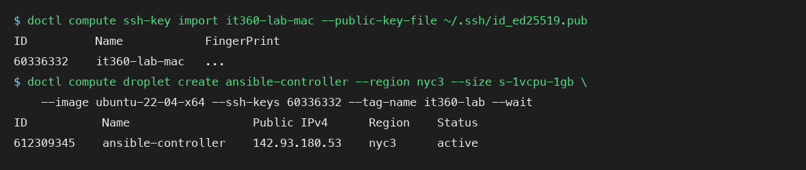
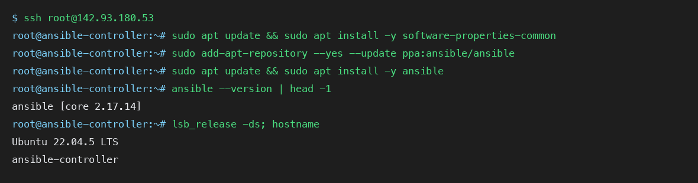
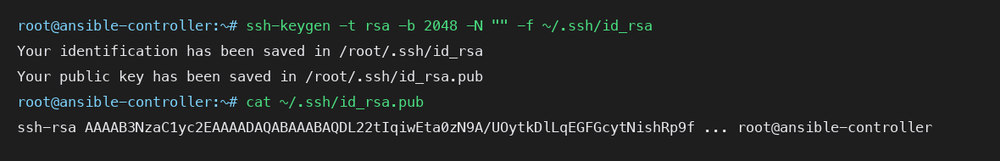
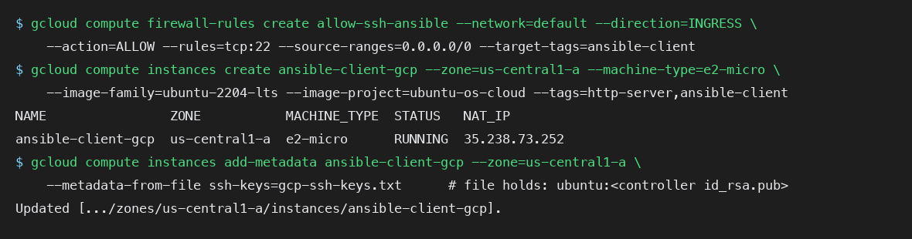
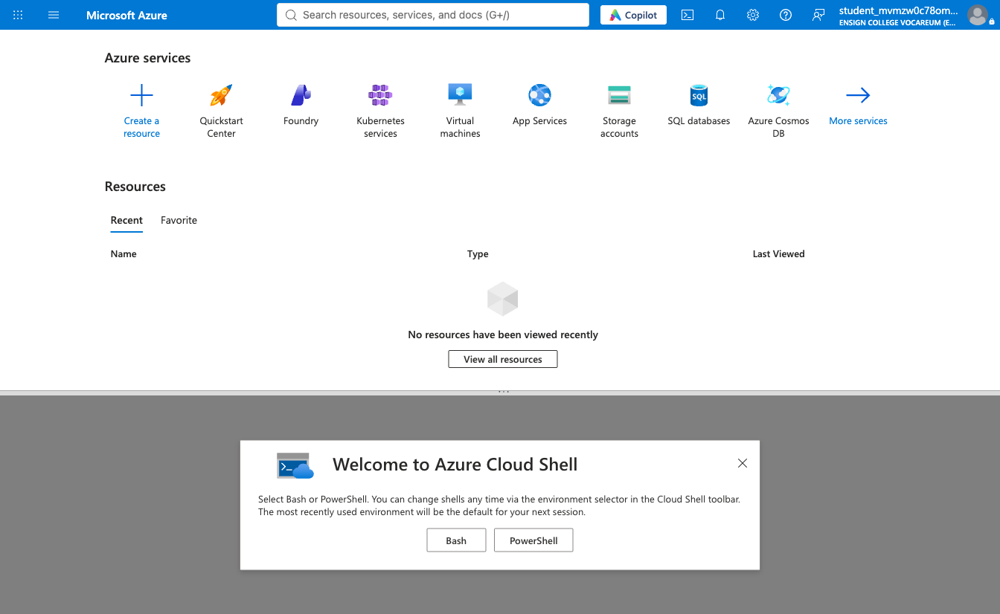
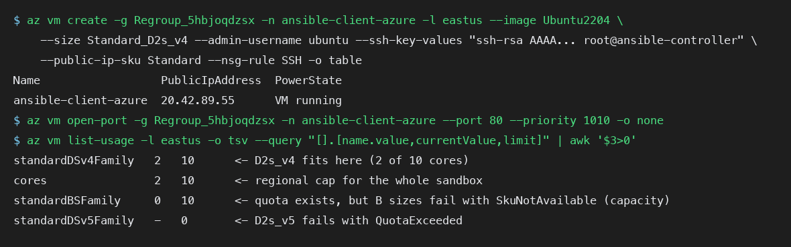
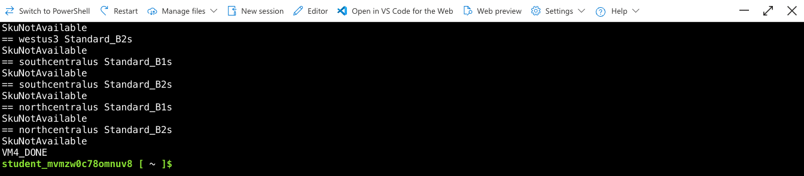
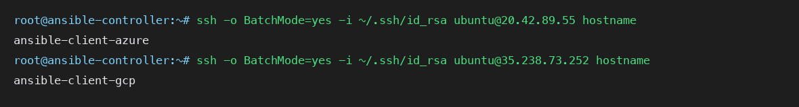
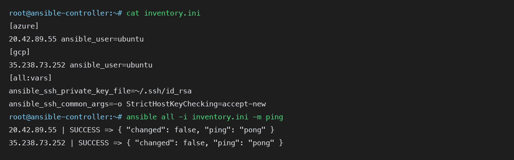
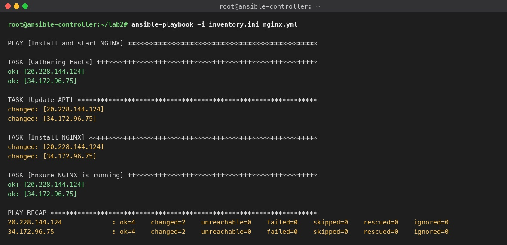

# Lab 2: Multi-Cloud Ansible Deployment (DigitalOcean controller, Azure and GCP clients)

**Course:** IT 360 Cloud Integration | **Week 1, Day 2** | **Canvas:** 1.6 Team Lab 2, Cross-Cloud Automation with Ansible | **Time:** 90 to 120 minutes

You will build one Ansible controller on DigitalOcean and use it to configure two
client servers that live on different clouds, one in Azure and one in Google Cloud.
A single inventory file and a single playbook install and start NGINX on both. No
passwords are used anywhere: the controller's SSH key is the only credential.

```
                     DigitalOcean (nyc1)
                 +-------------------------+
                 | ansible-controller      |
                 | Ubuntu 22.04 + Ansible  |
                 | ~/.ssh/id_rsa (fleet key)|
                 +-----------+-------------+
          SSH + key          |           SSH + key
        +--------------------+--------------------+
        v                                         v
+----------------------+               +----------------------+
| Azure                |               | Google Cloud         |
| ansible-client-azure |               | ansible-client-gcp   |
| Ubuntu 22.04, :22 :80|               | Ubuntu 22.04, :22 :80|
+----------------------+               +----------------------+
         inventory group [azure]             inventory group [gcp]
```

**Click-by-click handout:** `Lab 2 Click-by-Click - Cross-Cloud Automation with Ansible.docx` in this folder is the
screenshot-driven version of this guide: every console step on DigitalOcean, Google Cloud and Azure has a numbered
screenshot of where to click (`images/clicks/`) with a "What you see" description, every terminal step shows the real
output of the 2026-10-29 instructor run, and Part E lists the verification commands (`ansible-inventory --graph`, ad-hoc
`command`/`shell`/`uri` modules, `--check`, `setup` facts, `--syntax-check`). Generated with `docgen/build-click-guide.js`. Version 2026-10-30 adds the DigitalOcean sign-up links and Step 1A, the controller on AWS EC2 for students without a DigitalOcean account.

## Learning objectives

1. Set up an Ansible controller on a cloud provider (DigitalOcean) and install Ansible from the official PPA.
2. Provision Ubuntu 22.04 client VMs in Azure and Google Cloud with SSH and HTTP open.
3. Configure passwordless SSH from the controller to every client using one key pair.
4. Write an Ansible inventory that groups hosts by cloud.
5. Write and run a playbook that installs and starts NGINX on all clients, and prove it in a browser.
6. Explain idempotency by running the playbook twice.

## Follow-along video

`videos/lab2-objectives-and-walkthrough.mp4` explains the objectives and shows each
key step with real screenshots from the instructor run. Watch it once before you start.

## Naming used in this guide

| Item | Instructor run (2026-10-26, own accounts) | Yours |
|---|---|---|
| Controller | ansible-controller, DigitalOcean nyc1, 161.35.113.11 | |
| GCP client | ansible-client-gcp, project jackson-isiko, us-central1-a, 136.116.113.167 | |
| Azure client | ansible-client-azure, resource group ansible-lab-rg, eastus, Standard_B1s, 20.120.93.23 | |
| Fleet key on controller | ~/.ssh/id_rsa | |

Write your own values in the right-hand column. Every IP in this guide is from the
instructor run and will be different for you.

Rerun 2026-10-29 with `scripts/deploy-lab2.sh jackson-isiko`: controller 67.205.184.23 (nyc1),
GCP client 34.172.96.75, Azure client 20.228.144.124 (Standard_B1s accepted in eastus), ping pong on
both, first playbook `changed=2`, idempotent run `changed=0`, both pages HTTP 200, 8 minutes end to end.
One fix from that run: `doctl ... --wait` reports the droplet active a few seconds before its public IPv4
is assigned, so the script now polls for the IP instead of continuing with an empty one.

## Before you start

- A DigitalOcean account where you can create a droplet. Sign up at
  <https://cloud.digitalocean.com/registrations/new> (the trial page <https://try.digitalocean.com/freetrialoffer/>
  lands on the same form); a new account gets DigitalOcean's starting credit (advertised as $200 for 60 days at
  the time of writing) once a card or PayPal account is added. Students can also claim the DigitalOcean credit in
  the GitHub Student Developer Pack, <https://education.github.com/pack>, with a school e-mail and no card.
  **If you cannot open a DigitalOcean account** (card refused, no trial in your country, account on hold), build
  the controller on AWS EC2 instead: see *Controller on AWS instead* under Part 1 and Step 1A of the click-by-click
  handout. Everything after Part 1 is the same.
- A GCP project where you can create a VM and firewall rules: your own project, or the Vocareum
  **Google Cloud Lab** (which cannot create firewall rules, see Troubleshooting). The instructor's
  project for this course is `jackson-isiko`.
- An Azure subscription: your own (free account or credits; the instructor uses the
  *Ensign College - School Card* subscription in the Default Directory tenant) or the free Vocareum
  **Azure Sandbox**. On the sandbox, have the Microsoft Authenticator app on your phone: it forces
  enrolment on first sign-in (see Part 2).
- A terminal with `ssh`. For the one-command path you also need `doctl`, `gcloud` and `az` signed in, and an SSH key
  uploaded to DigitalOcean named `it360-lab-mac` whose private key is `~/.ssh/id_ed25519` on the laptop; the script
  stops with `DigitalOcean has no SSH key named it360-lab-mac` otherwise. If your key has another name or file (the
  Step 1 CLI imports it as `my-laptop`), run `DO_SSH_KEY_NAME=<name> LOCAL_KEY=<path> bash scripts/deploy-lab2.sh <GCP_PROJECT_ID>`.

**One command instead of Parts 1 to 5:** `bash scripts/deploy-lab2.sh <GCP_PROJECT_ID>` builds all
three VMs, wires the key, writes the inventory, runs the playbook twice and curls both pages
(about 8 minutes). `bash scripts/verify-lab2.sh` re-checks a running lab and
`bash scripts/rollback-lab2.sh <GCP_PROJECT_ID> -y` removes everything. Use them for the demo, then
do the parts by hand once so you can explain each step. The architecture is drawn in
[`../architecture/`](../architecture/README.md).

---

## Part 1. Controller VM on DigitalOcean (15 min)

### Step 1. Create the droplet

Console: **Create → Droplets**.

| Setting | Value |
|---|---|
| Region | New York (nyc1) or the one nearest you |
| Image | Ubuntu 22.04 LTS x64 |
| Size | Basic, Regular, 1 vCPU / 1 GB (s-1vcpu-1gb) |
| Authentication | SSH key. Add your laptop's public key so you can log in as root |
| Hostname | ansible-controller |

CLI alternative with doctl, after `doctl auth init`:

```bash
doctl compute ssh-key import my-laptop --public-key-file ~/.ssh/id_ed25519.pub
doctl compute droplet create ansible-controller --region nyc1 --size s-1vcpu-1gb \
  --image ubuntu-22-04-x64 --ssh-keys <KEY_ID> --wait
```



**Controller on AWS instead (no DigitalOcean account).** The controller is a plain Ubuntu 22.04 VM, so an EC2
instance in the AWS account or Vocareum AWS sandbox from Lab 1 works the same. Launch it the way you launched
`apacheserver1` in Lab 1 Step 1, with these values; the click-by-click handout shows every page in Step 1A.

| Setting | Value |
|---|---|
| Name | ansible-controller |
| AMI | Ubuntu Server 22.04 LTS (Canonical, owner 099720109477, via Browse more AMIs → Community AMIs) |
| Instance type | t3.micro (t2.micro on Vocareum) |
| Key pair | Create `ansible-controller-key` (.pem) or use Vocareum's `vockey` |
| Security group | SSH from My IP only; no HTTP, the controller is not a web server |
| Storage | 8 GiB |

CLI alternative from AWS CloudShell (region us-east-2; the AMI lookup and `run-instances` are the Lab 1 commands with
the names changed):

```bash
export AWS_DEFAULT_REGION=us-east-2
aws ec2 create-key-pair --key-name ansible-controller-key --query KeyMaterial --output text > ~/.ssh/ansible-controller-key.pem
chmod 400 ~/.ssh/ansible-controller-key.pem
VPC=$(aws ec2 describe-vpcs --filters Name=isDefault,Values=true --query 'Vpcs[0].VpcId' --output text)
SG=$(aws ec2 create-security-group --group-name ansible-controller-sg --description "SSH to the Ansible controller" --vpc-id $VPC --query GroupId --output text)
aws ec2 authorize-security-group-ingress --group-id $SG --protocol tcp --port 22 --cidr "$(curl -s https://checkip.amazonaws.com)/32"
AMI=$(aws ec2 describe-images --owners 099720109477 \
  --filters 'Name=name,Values=ubuntu/images/hvm-ssd/ubuntu-jammy-22.04-amd64-server-*' 'Name=state,Values=available' \
  --query 'sort_by(Images,&CreationDate)[-1].ImageId' --output text)
ID=$(aws ec2 run-instances --image-id $AMI --instance-type t3.micro --key-name ansible-controller-key \
  --security-group-ids $SG --associate-public-ip-address \
  --tag-specifications 'ResourceType=instance,Tags=[{Key=Name,Value=ansible-controller}]' \
  --query 'Instances[0].InstanceId' --output text)
aws ec2 wait instance-running --instance-ids $ID
aws ec2 describe-instances --instance-ids $ID --query 'Reservations[0].Instances[0].PublicIpAddress' --output text   # CONTROLLER_IP
```

The only differences from the droplet: log in as `ubuntu` (`ssh -i ~/.ssh/ansible-controller-key.pem ubuntu@CONTROLLER_IP`)
instead of `root`, the fleet key of Step 3 lands in `/home/ubuntu/.ssh/id_rsa`, and clean-up is **EC2 → Instance
state → Terminate**, then delete the security group and key pair. The GCP firewall rule and the Azure NSG rule
take the EC2 public IP as the controller IP. The lab is still cross-cloud: an AWS controller driving Google Cloud
and Azure clients.

**Where to run that ssh command.** The CloudShell block writes the `.pem` into CloudShell's `~/.ssh`, and the security
group rule holds CloudShell's outgoing IP (the `curl checkip` runs in CloudShell, not on your laptop). So SSH to the
controller from CloudShell, or create the key pair and the SSH rule from your laptop instead; from the laptop the
CloudShell-made controller fails twice, with no key file and with port 22 closed.

### Step 2. Log in and install Ansible

```bash
ssh root@<CONTROLLER_IP>
sudo apt update && sudo apt install -y software-properties-common
sudo add-apt-repository --yes --update ppa:ansible/ansible
sudo apt update && sudo apt install -y ansible
ansible --version
```



**Checkpoint 1:** `ansible --version` prints a version on the controller.

### Step 3. Generate the fleet SSH key on the controller

```bash
ssh-keygen -t rsa -b 2048 -N "" -f ~/.ssh/id_rsa
cat ~/.ssh/id_rsa.pub
```

Copy the whole `ssh-rsa ...` line. You will paste it into both clouds.



The helper script `scripts/01-controller-bootstrap.sh` does Steps 2 and 3 in one go.

---

## Part 2. Client VMs in Google Cloud and Azure (20 min, in parallel)

### Google Cloud

Console: **Compute Engine → VM instances → Create instance**. Name
`ansible-client-gcp`, region us-central1, e2-micro, boot disk Ubuntu 22.04 LTS,
firewall **Allow HTTP traffic**, and under **Networking** add the network tag `ansible-client`.
Then **VPC network → Firewall** and make sure a rule allows TCP 22 to the VM (the default
network has `default-allow-ssh`; if your project does not, create one with target tag
`ansible-client` and source `<CONTROLLER_IP>/32`).

CLI equivalent (Cloud Shell or gcloud):

```bash
gcloud compute firewall-rules create allow-ssh-ansible --network=default --direction=INGRESS \
  --action=ALLOW --rules=tcp:22 --source-ranges=<CONTROLLER_IP>/32 --target-tags=ansible-client
gcloud compute instances create ansible-client-gcp --zone=us-central1-a --machine-type=e2-micro \
  --image-family=ubuntu-2204-lts --image-project=ubuntu-os-cloud --tags=http-server,ansible-client
```

Add the controller's public key: **VM instances → ansible-client-gcp → Edit → SSH keys →
Add item**, paste the key, and make sure the comment at the end of the key is `ubuntu`
(GCP uses it as the username). CLI equivalent:

```bash
printf 'ubuntu:%s\n' "$(cat controller_id_rsa.pub)" > gcp-ssh-keys.txt
gcloud compute instances add-metadata ansible-client-gcp --zone=us-central1-a \
  --metadata-from-file ssh-keys=gcp-ssh-keys.txt
```

Record the **External IP**.



### Azure

**Path A: your own subscription (laptop, `az login` done).** The client gets SSH only from the
controller's IP and HTTP from everywhere, in a resource group the lab owns:

```bash
CIP=<CONTROLLER_IP>
az group create -n ansible-lab-rg -l eastus
az vm create -g ansible-lab-rg -n ansible-client-azure -l eastus --image Ubuntu2204 \
  --size Standard_B1s --admin-username ubuntu --ssh-key-values controller_id_rsa.pub \
  --public-ip-sku Standard --nsg-rule NONE -o table
az network nsg rule create -g ansible-lab-rg --nsg-name ansible-client-azureNSG -n allow-ssh-from-controller \
  --priority 1000 --protocol Tcp --source-address-prefixes $CIP/32 --destination-port-ranges 22 --access Allow
az network nsg rule create -g ansible-lab-rg --nsg-name ansible-client-azureNSG -n allow-http \
  --priority 1010 --protocol Tcp --destination-port-ranges 80 --access Allow
az vm show -d -g ansible-lab-rg -n ansible-client-azure --query publicIps -o tsv
```

If `Standard_B1s` is refused (`SkuNotAvailable`), try `Standard_B2s` then `Standard_D2s_v4`.
Record the public IP and skip to Checkpoint 2.

**Path B: the Vocareum Azure Sandbox (free, portal Cloud Shell only).**

1. In Vocareum open **Azure Sandbox**, start the lab, and click **Launch Azure Portal**. Sign in with the sandbox username and password shown in the Vocareum panel.
2. On first sign-in the tenant requires **Microsoft Authenticator**. Install it on your phone, choose *Work or school account*, scan the QR code the portal shows, and approve the prompt. This enrolment is for the throwaway sandbox account only.
3. In the portal open **Cloud Shell** (the `>_` icon), choose **Bash**, pick *No storage account required* and the Vocareum Azure Subscription, then Apply.



4. Create the VM from Cloud Shell. The sandbox pre-creates one resource group; find it and use it.

```bash
az group list -o table                      # note the pre-created resource group name
RG=<RESOURCE_GROUP>                        # instructor's Vocareum run, 2026-10-24: Regroup_5hbjoqdzsx
az vm create -g $RG -n ansible-client-azure -l eastus --image Ubuntu2204 \
  --size Standard_D2s_v4 --admin-username ubuntu \
  --ssh-key-values "<paste the controller's ssh-rsa line here>" \
  --public-ip-sku Standard --nsg-rule SSH -o table
az vm open-port -g $RG -n ansible-client-azure --port 80 --priority 1010
```

Record the **publicIpAddress**. Portal alternative: **Virtual machines → Create**,
Ubuntu 22.04, username `ubuntu`, authentication *SSH public key* with *Use existing
public key* and the controller's key pasted in, inbound ports SSH and HTTP.

**Which region and size: read this before you create the VM.** The Vocareum
sandbox subscription has two separate limits, and the error text tells you which
one you hit:

| Error from `az vm create` | Meaning | What to do |
|---|---|---|
| `SkuNotAvailable ... Capacity Restrictions` | Azure will not place that size for this subscription in that region, even when quota exists | Change region or size. In the instructor run every B-series and most D sizes failed this way in westus, westus2, centralus and eastus2 |
| `QuotaExceeded ... standardDSv5Family Cores quota` | The subscription has zero cores for that VM family | Pick a family with a non-zero limit in `az vm list-usage` |

In the instructor's Vocareum run on 2026-10-24 the combination that worked was **eastus** with
**Standard_D2s_v4**. The eastus quota table explains why: the sandbox allows 10
cores per region in total, 10 for the DSv4 family, 10 for the BS family (but B sizes
are capacity-blocked), and 0 for DSv5. A 2-core D2s_v4 fits. If `az vm create`
fails, read the real error and the quota table with:

```bash
az vm create ... --debug 2>&1 | grep -o '"message": "[^"]*' | head -3
az vm list-usage -l <REGION> -o tsv --query "[].[name.value,currentValue,limit]" | awk '$3>0'
```





The Azure CLI on your own laptop is blocked for the sandbox account by Conditional
Access, which is why this guide uses the portal's Cloud Shell.

**Checkpoint 2:** both VMs show a public IP and ports 22 and 80 are open.

---

## Part 3. Secure communication: passwordless SSH (10 min)

From the controller, prove the key works on both clients. `BatchMode=yes` fails
instead of prompting, so if a hostname prints, no password was involved.

```bash
ssh -o BatchMode=yes -i ~/.ssh/id_rsa ubuntu@<GCP_IP> hostname
ssh -o BatchMode=yes -i ~/.ssh/id_rsa ubuntu@<AZURE_IP> hostname
```



If a host asks for a password, the key is not in that VM's `~/.ssh/authorized_keys`
for user `ubuntu`. Re-add it (Azure: **Reset password → Reset SSH public key**; GCP:
Edit → SSH keys) and try again. `ssh-copy-id` only helps once password login works,
which it does not on these images, so put the key in through the cloud console.

**Checkpoint 3:** both hostnames print with no prompt.

---

## Part 4. Inventory and playbook (15 min)

On the controller:

```bash
cat > inventory.ini <<'EOF'
[azure]
<AZURE_IP> ansible_user=ubuntu

[gcp]
<GCP_IP> ansible_user=ubuntu

[all:vars]
ansible_ssh_private_key_file=~/.ssh/id_rsa
ansible_ssh_common_args=-o StrictHostKeyChecking=accept-new
EOF
cat inventory.ini
```

```bash
cat > nginx.yml <<'EOF'
---
- name: Install and start NGINX
  hosts: all
  become: yes
  tasks:
    - name: Update APT
      apt:
        update_cache: yes

    - name: Install NGINX
      apt:
        name: nginx
        state: present

    - name: Ensure NGINX is running
      service:
        name: nginx
        state: started
        enabled: yes
EOF
cat nginx.yml
```

Both files are in this folder under `ansible/` if you prefer to copy them.

Test connectivity:

```bash
ansible all -i inventory.ini -m ping
```

Every host must answer `"ping": "pong"`.



**Checkpoint 4:** inventory and playbook exist, and ping returns pong for every host.

---

## Part 5. Run the playbook and verify (15 min)

```bash
ansible-playbook -i inventory.ini nginx.yml
```

Read the **PLAY RECAP**. Each host should show `failed=0` and `unreachable=0`, with
`changed` greater than zero on the first run.



Verify from a browser or with curl:

```bash
curl -s http://<AZURE_IP> | grep -o '<title>.*</title>'
curl -s http://<GCP_IP>   | grep -o '<title>.*</title>'
```

Both print `<title>Welcome to nginx!</title>`. Open both IPs in a browser and take
one screenshot with both tabs visible.

Run the playbook a second time and read the recap carefully. With the playbook
exactly as written you will see `changed=1` on every host, not zero. The only task
that changed is *Update APT*: `update_cache: yes` refreshes the package index on
every run, and Ansible reports that refresh as a change. Install NGINX and Ensure
NGINX is running both report `ok`, which is the idempotent behaviour you are
looking for.

To make the whole playbook report `changed=0`, tell the apt module that a cache
younger than an hour is good enough:

```yaml
    - name: Update APT
      apt:
        update_cache: yes
        cache_valid_time: 3600
```

That version is in `ansible/nginx-idempotent.yml`. In the instructor run it gave
`ok=4 changed=0 failed=0` on both hosts. Idempotency means the playbook describes
an end state, and nothing changes when the state is already correct.

**Checkpoint 5:** NGINX is running on all target VMs, proven by the recap and the browser.

---

## Troubleshooting

| Symptom | Cause | Fix |
|---|---|---|
| `Permission denied (publickey)` from the controller | Key not installed for user `ubuntu` on that VM | Re-add the controller's public key via the cloud console; on GCP the key comment must be `ubuntu` |
| `ssh: connect to host ... port 22: Connection timed out` | Port 22 closed | Azure: NSG inbound rule for 22. GCP: firewall rule for tcp:22 to the VM's tag |
| Browser times out on port 80 | Port 80 closed | `az vm open-port --port 80` or GCP rule `default-allow-http` with tag `http-server` |
| `ansible: command not found` right after install | Shell has not re-read PATH | Open a new shell or run `hash -r` |
| Ansible warns about the Python interpreter | Informational | Add `ansible_python_interpreter=/usr/bin/python3` under `[all:vars]` to silence it |
| Azure: `SkuNotAvailable` for every size | Sandbox subscription capacity restriction in that region | Try another region; eastus worked for the quota check in the instructor run |
| Azure: `QuotaExceeded ... Family Cores quota` | That VM family has no cores allowed | `az vm list-usage -l <region> -o table`, pick a family with a non-zero limit |
| Azure CLI on laptop: "You don't have access to this" | Conditional Access blocks the CLI app for sandbox users | Use Cloud Shell in the portal |
| Azure sign-in loops on Authenticator | Code expired or wrong account in the app | Use a fresh 30-second code, or *Sign in another way* |
| GCP: cannot create firewall rule (Vocareum) | The lab role lacks the permission | Use a personal GCP project (see Instructor notes), or a project whose `default-allow-ssh` and `default-allow-http` rules already exist |

## Cleanup

Everything here is billable until deleted.

```bash
# DigitalOcean
doctl compute droplet delete ansible-controller --force
# Google Cloud
gcloud compute instances delete ansible-client-gcp --zone=us-central1-a --quiet
gcloud compute firewall-rules delete allow-ssh-ansible --quiet      # only if you created it
# Azure, own subscription: the whole lab group
az group delete -n ansible-lab-rg --yes
# Azure, Vocareum sandbox (Cloud Shell): just the VM, the group is pre-created
az vm delete -g <RESOURCE_GROUP> -n ansible-client-azure --yes
```

If you used the Vocareum labs, end them when you are done so the sandbox stops the clock.

**One-command teardown.** The scripts below find the lab's resources by name,
list them, ask once, then delete and print a "remaining" count. Add `-n` to
only list, `-y` to skip the prompt.

```bash
bash scripts/02-destroy-lab2-do.sh                  # droplet (doctl signed in)
bash scripts/03-destroy-lab2-gcp.sh jackson-isiko   # VM + allow-ssh-ansible rule (use your own project id)
bash scripts/04-destroy-lab2-azure.sh               # own subscription: deletes ansible-lab-rg whole
bash scripts/04-destroy-lab2-azure.sh <RESOURCE_GROUP>   # Vocareum (Cloud Shell): VM, NIC, IP, NSG, VNet, disk
bash scripts/rollback-lab2.sh jackson-isiko -y      # all three, skipping any CLI that is not signed in
```

On the Vocareum sandbox the resource group is pre-created and stays; the script empties
it of everything named `ansible-client-azure*`.

## Deliverables (Canvas 1.6)

1. `inventory.ini` and `nginx.yml`.
2. Screenshot of the PLAY RECAP for the first run, and of the second run showing `changed=0`.
3. One screenshot with both NGINX pages open side by side, addresses visible.
4. The Team Collaboration and Documentation section: who held the controller, Azure, GCP and automation roles, and what each contributed.

## Scripts in this folder

| Script | Where to run | Covers |
|---|---|---|
| `scripts/deploy-lab2.sh <PROJECT_ID>` | Laptop with doctl, gcloud and az signed in | Parts 1 to 5 end to end, printing every validation |
| `scripts/verify-lab2.sh [<PROJECT_ID>]` | Same | Lists the three VMs, pings, re-runs the idempotent playbook, curls both pages |
| `scripts/rollback-lab2.sh <PROJECT_ID> [-n] [-y]` | Same | All three teardowns (same as `destroy-lab2.sh`) |
| `scripts/01-controller-bootstrap.sh` | On the controller as root | Part 1 Steps 2 and 3 |
| `scripts/02-destroy-lab2-do.sh` | Anywhere doctl is signed in | Delete the controller droplet (`-n` dry run, `-y` no prompt) |
| `scripts/03-destroy-lab2-gcp.sh <PROJECT_ID>` | Cloud Shell or local gcloud | Delete the GCP client and its firewall rule |
| `scripts/04-destroy-lab2-azure.sh [RG]` | Laptop with az, or the portal Cloud Shell | Own subscription: delete `ansible-lab-rg`; sandbox: delete the client and its NIC, IP, NSG, VNet, disk |
| `scripts/destroy-lab2.sh <PROJECT_ID> [-n] [-y]` | Machine with the CLIs | Runs all three teardowns |
| `ansible/inventory.example.ini` | Copy to the controller as `inventory.ini` | Part 4 |
| `ansible/ansible.cfg` | Copy next to the inventory on the controller | Quiets the Python-interpreter warning, skips host-key prompts (deploy-lab2.sh installs it) |
| `ansible/nginx.yml` | Copy to the controller | Part 4 |
| `ansible/eda/rulebook.yml` | On the controller, with `ansible-rulebook` and the `ansible.eda` collection | Extension 3: re-runs `nginx-idempotent.yml` when a webhook says `nginx-down` |

## What changed in the industry, April to October 2026

- **Ansible Automation Platform 2.6 (June 2026):** the Lightspeed intelligent assistant is
  generally available as a chat inside the platform, an MCP server for AAP is GA (so AI
  agents can run approved automation through it), and Event-Driven Ansible gained external
  secret management and a Kafka source. Red Hat now describes Ansible as the "trusted
  execution layer" for agentic AI: the agent decides, Ansible executes with audit labels.
- **The pattern you built is the agent pattern.** One controller, an inventory, idempotent
  playbooks and a key with no password is exactly how an agent is given the ability to act
  on servers without being given the servers.
- **Keyless everywhere.** Managed identities on Azure, Workload Identity on GKE and OIDC
  federation for CI mean the fleet key you generated would, in production, be issued
  short-lived by the cloud rather than copied by hand (Week 5 does this).

### Across the providers: configuration automation targets (October 2026)

| Provider | What it offers for this week |
|---|---|
| AWS | EC2 as a third Ansible target (see cross-cloud-iac/aws); Systems Manager for agentless commands |
| Azure | The Lab 2 client; Azure Automation and Update Manager are the native equivalents |
| Google Cloud | The Lab 2 client; OS Config and VM Manager are the native equivalents |
| DigitalOcean | The Lab 2 controller; doctl and the API for droplet lifecycle |
| Oracle Cloud | OCI compute with instance principals; the Ansible OCI collection targets it the same way |

Market context (Synergy Research, Q2 2026): 143.4 billion dollars in the quarter, up 43 percent; AWS 28, Azure 20, Google 15 percent.

Sources for this section:
- https://docs.redhat.com/en/documentation/red_hat_ansible_automation_platform/2.6/whats_new-2.6_2026_06_03 (AAP 2.6: Lightspeed GA, MCP server, EDA)
- https://www.techzine.eu/news/infrastructure/141317/red-hat-makes-ansible-the-trusted-execution-layer-for-agentic-ai/
- https://www.redhat.com/en/blog/tracking-event-driven-automation-red-hat-lightspeed-and-red-hat-ansible-automation-platform-26

### AI and automation extension (optional, 30 min)

1. Generate `nginx.yml` with an AI assistant from the sentence *"install and start NGINX on
   Ubuntu, idempotent, with apt cache valid for an hour"*, then run `ansible-lint` on it and
   on the version in `ansible/`. Which one passes?
2. Add a third target from a third provider with `../cross-cloud-iac/aws` (an EC2 instance
   with the controller's key) and append it to the inventory under `[aws]`. Nothing in the
   playbook changes; that is the portability claim, now across three clouds.
3. Event-driven: the rulebook in `ansible/eda/rulebook.yml` listens on port 5000 and re-runs
   `nginx-idempotent.yml` when a `{"event": "nginx-down"}` payload arrives. Install
   `ansible-rulebook` and the `ansible.eda` collection, run it from `ansible/eda/` with
   `ansible-rulebook -i ../inventory.ini -r rulebook.yml`, trigger it with the `curl` line in the
   file's header, and watch the playbook run without a human.

## Instructor notes

- The course's official Use Case 1.6 (Peak Rentals) uses groups `[colorado]` and `[utah]` and adds a templated landing page task. This guide follows the Canvas lab text with `[azure]` and `[gcp]` groups; students can rename the groups and add the `copy` task from the lab guide PDF if you want the Peak Rentals deliverable.
- Vocareum Azure: the sandbox blocks the Azure CLI app, forces Authenticator enrolment, and restricts VM SKUs by region and quota. Budget 15 extra minutes for Azure on lab day. Tell students up front: region **eastus**, size **Standard_D2s_v4**, and that B-series sizes fail with SkuNotAvailable even though the BS family has quota. The sandbox caps a region at 10 cores, so a team cannot run more than five D2s_v4 VMs at once.
- Three instructor runs back this guide: 2026-10-24 on the Vocareum Azure Sandbox (resource group `Regroup_5hbjoqdzsx`, eastus with Standard_D2s_v4 after the B-series SkuNotAvailable refusals; README version at commit 082af5a), 2026-10-26 on own accounts (below), and the 2026-10-29 rerun with `deploy-lab2.sh` (see Naming used in this guide).
- Instructor run on 2026-10-26, own accounts only (no Vocareum): controller 161.35.113.11 on DigitalOcean nyc1, GCP client 136.116.113.167 in project `jackson-isiko` (the project's `default-allow-ssh` and `default-allow-http` rules were enough), Azure client 20.120.93.23 (Standard_B1s, eastus, group `ansible-lab-rg`, subscription *Ensign College - School Card*, SSH allowed only from the controller IP). `ansible all -m ping` returned pong from both, `nginx.yml` gave `ok=4 changed=2 failed=0` on both, `nginx-idempotent.yml` gave `changed=0` on both, and both IPs served "Welcome to nginx!".
- Azure CLI on the laptop: the Vocareum sandbox blocks it, but a personal tenant does not. `az login --use-device-code --tenant <tenant-id>` signs the laptop in without a browser on the same machine, which is what makes `deploy-lab2.sh` and `rollback-lab2.sh` one-command.
- Demo plan (Tuesday): run `deploy-lab2.sh` before class so the VMs are warm, show `verify-lab2.sh` live (ping, `changed=0`, both pages), then delete everything with `rollback-lab2.sh jackson-isiko -y` on screen (about 2 minutes).
- Vocareum GCP: the lab user cannot create firewall rules, so Lab 2 students should use a personal GCP project for the GCP client, exactly as in Lab 1.
